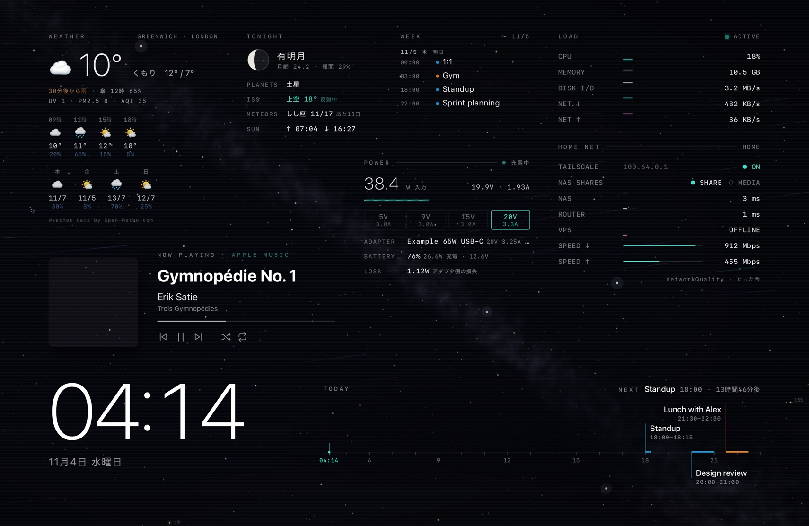

# Orbit Desktop

**A live, pluggable desktop for macOS.** The real night sky over your city as your wallpaper,
reacting to your Mac: stars twinkle harder and meteors fall when the CPU is busy, light trails
stream with network traffic, the Milky Way pulses with the bass of the music you're playing.
On top sit widgets for time, weather, system stats, now playing, today's schedule, and more.

Everything is a plugin, configured in one YAML file, and every plugin runs in a **sandboxed,
network-less frame**, so community widgets can't phone home with your calendar.

> Status: **early release** (macOS 14+, build from source). A Swift menu-bar app shows the wallpaper on every
> screen, provides the data and has a drag-and-drop layout editor.



## Features
* **Starfield background:** real stars (magnitude ≤ 6) for your location and time, the Milky Way, planets, the Moon
  with its phase, the ISS and meteor-shower radiants. CPU → twinkle and meteors, network → streamlines, bass → glow.
* **30 widgets**, each a calm module: clock, weather (with air quality, rain nowcast, pressure), load, home network
  (Tailscale, NAS shares you can mount with a click), USB-C power input with USB PD details, Mac (battery, Time
  Machine), cloud-folder usage, schedule timeline, week, month, now playing with playback buttons, recent tracks,
  tonight's sky, sky chart, world clock, holidays / FX / earthquakes, news, ISS, space weather, rocket launches,
  GitHub, Bluetooth devices, and more. All network and personal data sources are **off by default**.
* **Customise with the mouse:** ✦ → レイアウトを編集… opens an editor on the desktop itself. It has a library of
  widgets, an inspector with each widget's settings and data sources, drag / resize with snapping guides, smart-stack
  style rotation in any place, click actions (open an app or URL, run a Shortcut or script, control music),
  undo and preview.
* **Earthquake Early Warning** (Japan, P2P地震情報): a banner above every app, a notification and an optional music pause.
* **Plugin sandbox:** widgets run in opaque-origin iframes with a `default-src 'none'` CSP and get only the signals
  they declare in `needs:` ([docs/security.md](docs/security.md)).
* **Build your own widget in minutes**, by hand or with an AI agent: see [Writing widgets](#writing-widgets).

## Quick start (host app)

Requirements: macOS 14+ (14.2+ for audio reactions) and the Xcode Command Line Tools
(`xcode-select --install`).

```sh
git clone <this repo> ~/src/orbit-desktop && cd ~/src/orbit-desktop
host/app/build.sh --install      # builds "Orbit Desktop.app" into ~/Applications and starts it
```

Then use the ✦ menu-bar icon and choose **Edit layout.yaml…** to set `providers.location` to your
city. macOS asks for the Calendar and System Audio Recording permissions the first time a widget
needs them. Details, including how to keep permissions across rebuilds, are in
[host/app/README.md](host/app/README.md).

## Quick start (dev server + Plash)

Requirements: macOS 14+, Python 3.9+ (the system `python3` works; 3.13 is tested), and
[Plash](https://sindresorhus.com/plash) from the Mac App Store.

```sh
git clone <this repo> ~/src/orbit-desktop && cd ~/src/orbit-desktop
python3 tools/validate.py                         # sanity check: prints OK
mkdir -p ~/.config/orbit-desktop
cp examples/layout.yaml ~/.config/orbit-desktop/layout.yaml
$EDITOR ~/.config/orbit-desktop/layout.yaml       # set providers.location to your city
python3 host/dev-server/orbit_server.py           # http://127.0.0.1:47900/
```

1. Open `http://127.0.0.1:47900/?demo` in Safari to preview. `?demo` fakes load, network, audio
   and a playing track.
2. In Plash, choose **Add Website** and enter `http://127.0.0.1:47900/`.
3. Optional data sources, documented in [host/helpers](host/helpers/README.md):
   * `audiopulse`: the system-audio spectrum for music reactions
   * `calpulse`: calendar events for the schedule widget
   * `tcp-latency.sh`: LAN latency

The first time Apple Music or Spotify is queried, macOS asks for Automation permission.

## Configuration
One file: `~/.config/orbit-desktop/layout.yaml`. Start from
[`examples/layout.yaml`](examples/layout.yaml). The full reference is in
[docs/configuration.md](docs/configuration.md):
* theme fonts, colours and locale
* backgrounds and `react:` hooks
* widget anchors, offsets and sizes
* providers: location, ping targets, speed test, …

```yaml
theme: { accent: auto, locale: auto }
background: { use: starfield, react: { cpu: [twinkle, meteors], audio.bass: glow } }
widgets:
  - use: clock
    position: { anchor: bottom-left, x: 6vw, y: 11vh }
```

## Writing widgets
A widget is a folder (`widget.yaml` + `widget.js` + optional `style.css`) with no build step:

```sh
python3 tools/new-widget.py tide --name "Tide" --needs time,weather --category weather
python3 tools/dev-widget.py tide           # live preview with sample data, no permissions needed
python3 tools/validate.py
```

* Guide: [docs/widgets.md](docs/widgets.md)
* For AI agents: [AGENTS.md](AGENTS.md) and [llms.txt](llms.txt)
* Machine-readable contracts:
  * SDK types: [runtime/sdk/orbit-sdk.d.ts](runtime/sdk/orbit-sdk.d.ts)
  * manifest schema: [schemas/widget.schema.json](schemas/widget.schema.json)
  * one schema per signal: [schemas/signals/](schemas/signals/)
  * sample data: [examples/mock/](examples/mock/)

Contributions are welcome: see [CONTRIBUTING.md](CONTRIBUTING.md).

## Architecture

```
layout.yaml ──► Orbit Desktop.app (Swift): desktop windows, native system / audio / calendar
                 └─ child: dev server (Python)
                      ├─ validates config + manifests (stdlib YAML subset)
                      ├─ providers: now playing · weather · location · ping · …
                      └─ Provider API (HTTP + SSE on 127.0.0.1)  ── docs/provider-api.md
                          ▼
                 runtime page (trusted) ── postMessage (only declared `needs`) ──► plugin iframes
                                                                                    (sandbox, CSP: no network)
```

## Roadmap
* **Done:** plugin architecture and sandbox, Swift host app (desktop windows, native providers, EEW), the
  layout editor, 30 widgets, the widget SDK with schemas and AI-readable docs.
* **Next:** user-installable feeds (personal data sources), English UI strings for every widget, CoreLocation,
  a Homebrew cask, then a signed and notarized build.
* **Later:** a plugin gallery, per-plugin permission prompts for sensitive signals, per-display layouts.

## License
MIT © DaiconMan. Third-party data and services are listed in
[THIRD_PARTY_NOTICES.md](THIRD_PARTY_NOTICES.md).

The star catalogue is BSD-3-Clause (d3-celestial). Weather data is © Open-Meteo, CC BY 4.0.
